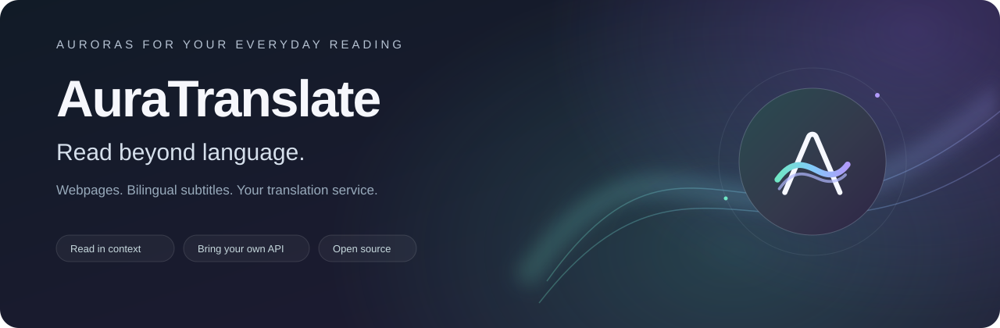
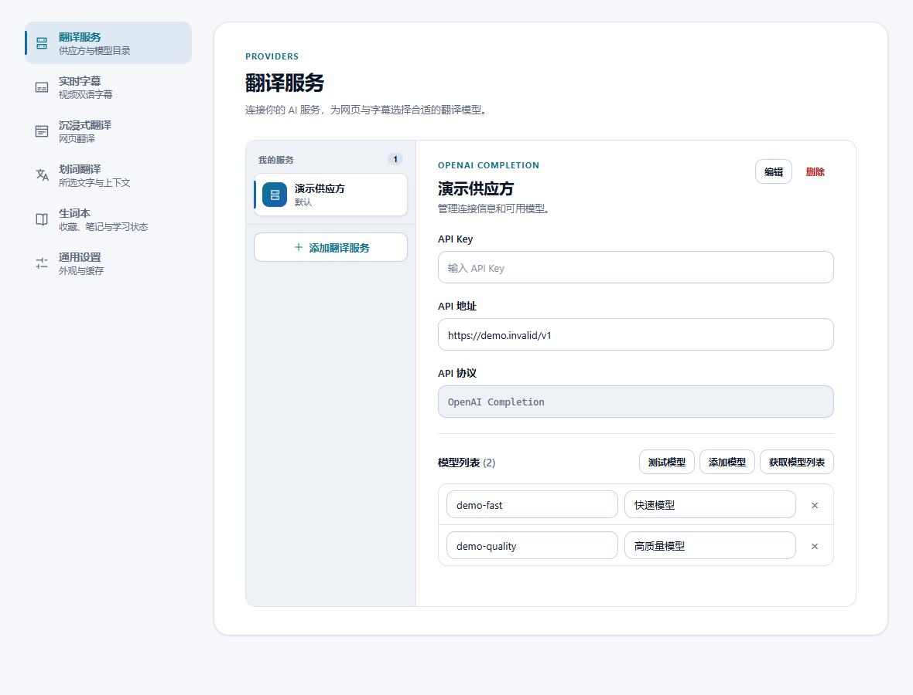
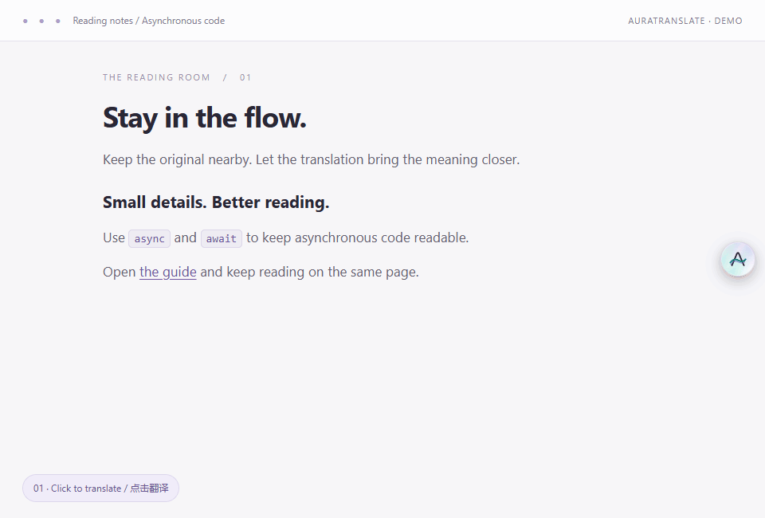
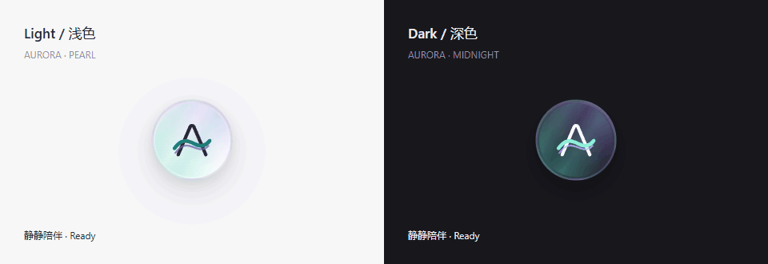
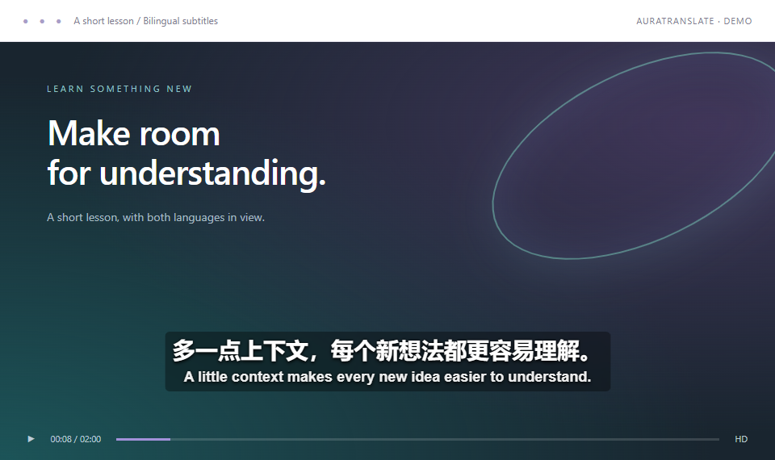

<div align="center">



**English** · [简体中文](README_zh.md)

**Bilingual reading, right where you are.**

Translate webpages in place. Follow video lessons with English and Chinese subtitles.<br>
Choose your own AI provider, or try webpage translation with Google without an API key.

[](LICENSE)


[Quick start](#quick-start) · [Webpages](#webpage-translation) · [Video tools](#video-tools) · [Browser support](#browser-support) · [Development](#development)

</div>

AuraTranslate is an open-source browser extension for reading foreign-language articles and watching captioned lessons. Webpage translations appear alongside the original text; video tools bring subtitles, a searchable transcript, and an AI summary into the player.

| Feature | What you can do |
| --- | --- |
| Webpage translation | Read bilingual text or show only the translation, with links and common inline formatting preserved. |
| Page context | Let AI analyze the page topic and build a shared glossary before translating paragraphs. |
| Selection translation | Select a word or passage and click the nearby button; AI uses surrounding context to resolve meaning. |
| Vocabulary notebook | Save text, translations, context and sources; search, add notes, track learned entries, and import/export backups. |
| Video subtitles | Translate existing English captions on YouTube and accessible Google Drive transcripts into Simplified or Traditional Chinese. |
| Transcript and summary | On YouTube, search captions, jump to timestamps, follow playback, and generate a summary on demand. |
| Your own services | Connect OpenAI-compatible, OpenAI Responses, Anthropic Messages, or Gemini APIs; manage model catalogs and choose separate services for webpages and subtitles. |
| Local reuse | Reuse matching translations and summaries from the browser's local cache. |

## Quick start

### 1. Load the extension

[Download the source ZIP](https://github.com/cai2761m/auratranslate/archive/refs/heads/main.zip) and extract it, or clone the repository:

```sh
git clone https://github.com/cai2761m/auratranslate.git
```

In desktop **Chrome** or **Edge**:

1. Open `chrome://extensions` or `edge://extensions`.
2. Enable **Developer mode** and choose **Load unpacked**.
3. Select the extracted folder containing `manifest.json`.
4. Pin AuraTranslate to the toolbar and open its popup.

The repository includes the built popup and settings pages. **You do not need Node.js or npm to install and use this copy.** Firefox has a different installation process; see [Browser support](#browser-support).

### 2. Choose a translation service

**To try webpage translation:** select **Google 翻译 · 免 Key** in the popup, then click **翻译当前网页** (Translate current page). This option needs no API key, but network restrictions and rate limits can affect availability.

**For AI webpage translation, video subtitles, and summaries:**

1. Open **设置 → 翻译服务** (Settings → Translation services).
2. Click **添加自定义供应方** (Add custom provider).
3. Select the provider's API protocol, then enter its API address, your API key, and at least one exact model ID.
4. Under **实时字幕** (Video subtitles), select that provider and model. **沉浸式翻译** (Webpage translation) inherits this selection by default; you can select another provider or model there.

| Field | What to enter |
| --- | --- |
| Provider name | A label you recognize |
| API address | The base URL for the selected API protocol; see the examples below |
| API key | Your own provider credential |
| Models | Exact model IDs; display names are optional. You can also fetch a model list or test a model. |

Choose the protocol that matches the endpoint, rather than the model name. These formats use different authentication headers, request bodies, and response parsers:

| API protocol | Official service base URL | Generation endpoint |
| --- | --- | --- |
| [OpenAI-compatible API](https://developers.openai.com/api/reference/resources/chat/subresources/completions/methods/create) | Your provider's compatible base URL | `/chat/completions` |
| [OpenAI Responses](https://developers.openai.com/api/docs/guides/migrate-to-responses) | `https://api.openai.com/v1` | `/responses` |
| [Anthropic Messages](https://platform.claude.com/docs/en/api/messages/create) | `https://api.anthropic.com/v1` | `/messages` |
| [Google Gemini](https://ai.google.dev/api/generate-content) | `https://generativelanguage.googleapis.com/v1beta` | `/models/{model}:generateContent` |

For a relay or local service, use its own base URL and supported protocol. A compatible base such as `https://api.example.com/v1` becomes `https://api.example.com/v1/chat/completions`; this example is a placeholder. Full generation URLs are also accepted. Model fetching and tests use the selected protocol. [Ollama](https://docs.ollama.com/api/openai-compatibility) can use OpenAI-compatible mode with `http://localhost:11434/v1` and a placeholder key such as `ollama`.

JSON output mode uses structured schemas for Responses and Anthropic. Turn it off if the selected model or relay does not support structured output.



Settings save automatically. **No API key or usage credit is included.** Your provider may charge for translations, model tests, sentence segmentation, page-context analysis, and new summaries. Google without a key is a webpage option; video translation and summaries use your configured AI service.

### 3. Translate a page or open a video

- **Webpage:** click the floating **A**, or use **翻译当前网页** in the popup. The default direction is automatic source detection → Simplified Chinese.
- **YouTube:** open a video with English captions. The AuraTranslate icon in the player controls opens subtitle settings, the floating transcript, and AI summary.
- **Google Drive:** open a video with an accessible transcript. The extension briefly opens the transcript panel to read it, then restores its previous state.

The current popup and settings interface is in Chinese; the instructions above use the labels shown in the extension.

## Webpage translation

AuraTranslate prioritizes visible text and displays matching cached translations first. Headings, lists, links, and inline code retain their structure where the page extractor supports it.



[View a still image](docs/assets/immersive-preview.png).

- **Keep the original close:** switch between bilingual and translation-only display using the icon beside the popup's Translate button.
- **Hide and restore:** after translation finishes, click the floating A to hide or show the completed results.
- **Automate per site:** expand **更多功能** (More features) to follow the global setting, always translate the current site, or never translate it. Global automatic translation is off by default.
- **Hide the floating control:** use its close button to dismiss it until refresh or disable it on the current site. Manage saved sites under **设置 → 沉浸式翻译 → 禁用小球的网站**.
- **Keep terms consistent:** with AI deep context enabled, batches share a page glossary. This adds an initial analysis step; long pages use sampled excerpts.

The floating A adapts to the page background and can be dragged. Keyboard operation and reduced-motion preferences are supported.

<details>
<summary><strong>Preview the floating control</strong></summary>



The showcase enlarges the control; its actual size is 44 px. [View a still image](docs/assets/aurora-preview.png).

</details>

## Selection translation and vocabulary

1. Select a word, phrase or passage on a webpage, then click the nearby translation icon (up to 3,000 characters).
2. Translation uses the webpage service and language settings in the popup. Selecting text alone makes no provider request; AI translation includes nearby context.
3. Click **收藏到生词本** to save the source, translation, context, source link and date.
4. Open **生词本** from the popup or settings to search entries, add notes, mark them learned, delete entries, or undo the most recent deletion.

The notebook stores up to 5,000 entries locally in the current browser. Matching text and translations are deduplicated; different meanings remain separate. Export JSON for complete backups and import JSON to merge entries while preserving existing learning progress. Export CSV for spreadsheet use. Clearing translation caches preserves the notebook.

Selection translation is enabled by default and can be disabled under **设置 → 划词翻译**. Translation controls do not appear inside inputs or editable areas.

The default toolbar is a compact 28px icon. Under **设置 → 划词翻译 → 自定义划词工具栏**, add copy, notebook or close buttons, reorder them, choose 28/32/40px sizing, show text labels, or prefer placement above the selection. Changes save automatically and update open webpages; a live preview and reset are included.

## Video tools

AuraTranslate translates **existing captions or transcripts**. It does not record audio or transcribe videos that have no captions.



The default subtitle direction is **English → Simplified Chinese**; Traditional Chinese is also available. Drag the subtitle overlay to reposition it and adjust its size in settings.

On **YouTube**, open the AuraTranslate icon in the player controls:

| Tool | Controls |
| --- | --- |
| Video subtitles | Turn the translated overlay on or off. |
| Subtitle style | Choose bilingual, translation-only, or original-only display; adjust size, text color, and background opacity; reset position. |
| Floating transcript | Search captions, follow playback, click timestamps to seek, and drag the panel. Available even when translated subtitles are off. |
| AI summary | Click **生成总结** (Generate summary) to summarize the existing transcript, then copy the result. |

Opening the summary panel only checks for a cached result. New summaries use the selected subtitle provider and model; failed requests are not automatically retried. Whole-video summaries currently accept up to **120,000 transcript characters and 20,000 cues**.

In **Google Drive**, subtitle translation depends on a transcript accessible through the player. The YouTube transcript and summary controls described above are specific to YouTube.

All screenshots and animations use original demo material, sample text, and simulated provider responses with the production UI or rendering scripts. They illustrate behavior rather than live API speed, translation quality, or device compatibility. See [how the media is generated](docs/assets/README.md).

## Browser support

| Browser | Installation and current scope |
| --- | --- |
| Desktop Chrome / Edge | Load the extracted repository folder through Developer mode as described above. |
| Desktop Firefox | The manifest declares **140+**. For development, use [temporary installation](https://extensionworkshop.com/documentation/develop/temporary-installation-in-firefox/); it ends when Firefox restarts. Normal distribution requires a Mozilla-signed package. |
| Firefox for Android | The manifest declares **142+**. Persistent installation requires a signed package; see [Mozilla's installation guide](https://extensionworkshop.com/documentation/publish/install-self-distributed/). Use [Mozilla's Android development workflow](https://extensionworkshop.com/documentation/develop/developing-extensions-for-firefox-for-android/) for source testing. |

**The source ZIP is not a Mozilla-signed XPI.** A declared Firefox minimum version is not a claim of verified behavior on every device. Android compatibility still needs real-device testing. The extension works inside browser webpages, including mobile YouTube pages; it does not modify the native YouTube app.

## Defaults and API usage

| Setting | Default and options |
| --- | --- |
| Webpage display | Bilingual; translation-only is also available |
| Automatic webpage translation | Off; configurable globally and per site |
| Subtitle translation scope | Economy mode with a **2-minute** lookahead; choose 1 / 2 / 3 minutes or full video |
| Subtitle size | `1.00×`; range `0.30×–3.00×` |
| AI sentence segmentation | On; combines fragmented captions into sentences using the subtitle API |
| Caption correction | On; asks AI to correct obvious errors in existing captions |
| Original technical terms | On; retains source terms beside their translations |
| AI deep page context | On; analyzes topic and terminology before translation, with successful analysis cached |
| JSON output mode | On; disable it if your compatible service rejects this option |
| Interface theme | Follows the system; light and dark modes are available |

Economy mode translates captions around the current playback position and adjusts pending work after seeking. Full-video mode prioritizes nearby captions, then processes the rest. Already-sent requests may still finish and incur charges.

Changing display mode, subtitle size, or visibility reuses completed translations. Changing the model, endpoint, languages, source content, or relevant processing settings may require new results. Caches have capacity limits, so older entries can be evicted.

## Privacy and permissions

No AuraTranslate account is required. Webpage text and captions are sent to the translation service you choose. AI sentence segmentation sends caption text to the subtitle service; deep page context sends the page title and source excerpts to the webpage AI service. Google mode sends webpage text to Google's public translation endpoint without browser cookies.

Settings, API keys, overlay positions, translations, and summaries are stored in **browser extension local storage**. API keys are not additionally encrypted by the extension; the password field masks their display.

| Permission | Purpose |
| --- | --- |
| `storage` | Save settings, caches and vocabulary locally |
| HTTP / HTTPS host access | Read webpage text and captions, render translations, and contact configured providers, including local API endpoints |

Use **设置 → 通用设置 → 清空翻译缓存** to discard saved results. Subsequent translations may send new requests.

## Troubleshooting

| Symptom | What to check |
| --- | --- |
| A newly installed or updated extension does not appear | Reload the extension in the browser's extension manager, then refresh existing tabs. |
| The floating A is missing | Check the disabled-site list and site permissions. Browser internal pages are outside the extension's HTTP/HTTPS scope. |
| An AI request fails | Verify the base URL, exact model ID, API key, and model access. Turn off JSON output mode if the endpoint rejects it. |
| Google translation fails | Check network access and rate limits, or switch to a configured AI service. |
| Video subtitles are missing | Enable video subtitles and confirm English captions or an accessible Drive transcript exist. |
| Some webpage content is skipped | Forms, code blocks, and excluded regions are skipped; text in images, canvas, nested frames, or unsupported structures may not be extracted. |

If a webpage request times out with an uncertain result, AuraTranslate checks for late cached results instead of automatically resending that request. Completed paragraphs remain available. Return to the tab to recover results, or manually continue missing work. A request already sent to a provider can still complete and incur charges.

## Development

The popup and settings pages use **React + esbuild**. Content scripts and the translation engine use plain JavaScript.

Use Node.js satisfying the locked jsdom dependency: `^22.22.2 || ^24.15.0 || >=26.0.0`.

```sh
npm ci
npm run build
npm test
npm run test:ui:browser
```

The browser checks require installed Chrome. Set `UI_BROWSER=msedge` to use installed Edge; in PowerShell, use `$env:UI_BROWSER = "msedge"`. If PowerShell blocks `npm.ps1`, use `npm.cmd`.

| Command | Purpose |
| --- | --- |
| `npm run dev` | Watch and rebuild the React UI |
| `npm run build:check` | Check that committed UI bundles match their sources; also runs before `npm test` |
| `npm run preview` | Preview the popup and settings at `http://127.0.0.1:5174` with simulated browser APIs |
| `npm run test:ui:browser` | Check the production UI, floating control, player tools, and settings in a browser |
| `npm run test:vocabulary:browser` | Load the real extension in isolated Chrome and check selection, vocabulary, backups and mobile layouts with a local provider fixture |
| `npm run icons` | Regenerate extension icons |

| Directory | Contents |
| --- | --- |
| `ui/` | React popup, settings, and shared components |
| `src/` | Page extraction, translation requests, captions, caching, and in-page controls |
| `popup/`, `options/` | Extension pages and generated UI bundles |
| `scripts/` | Builds, previews, browser checks, benchmarks, and media generation |
| `test/` | Automated tests and fixtures |
| `docs/assets/` | README images and animations |

Edit the React sources rather than generated `popup/popup.js` or `options/options.js`, and include rebuilt bundles with UI changes. Local previews and browser checks use simulated storage and provider responses. Real provider, website, and mobile-device validation must be performed separately.

## Contributing

[Open an issue](https://github.com/cai2761m/auratranslate/issues) with the page URL, browser and version, reproduction steps, and error text. Remove API keys and private content from logs and screenshots. Focused fixes, documentation improvements, and reproducible examples are welcome.

Licensed under [MIT](LICENSE).
